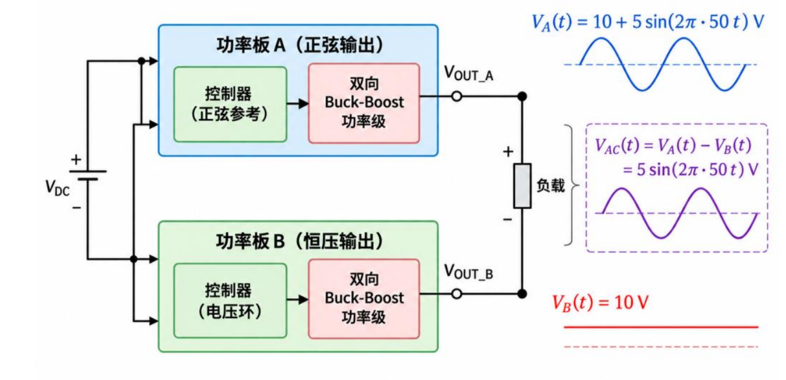
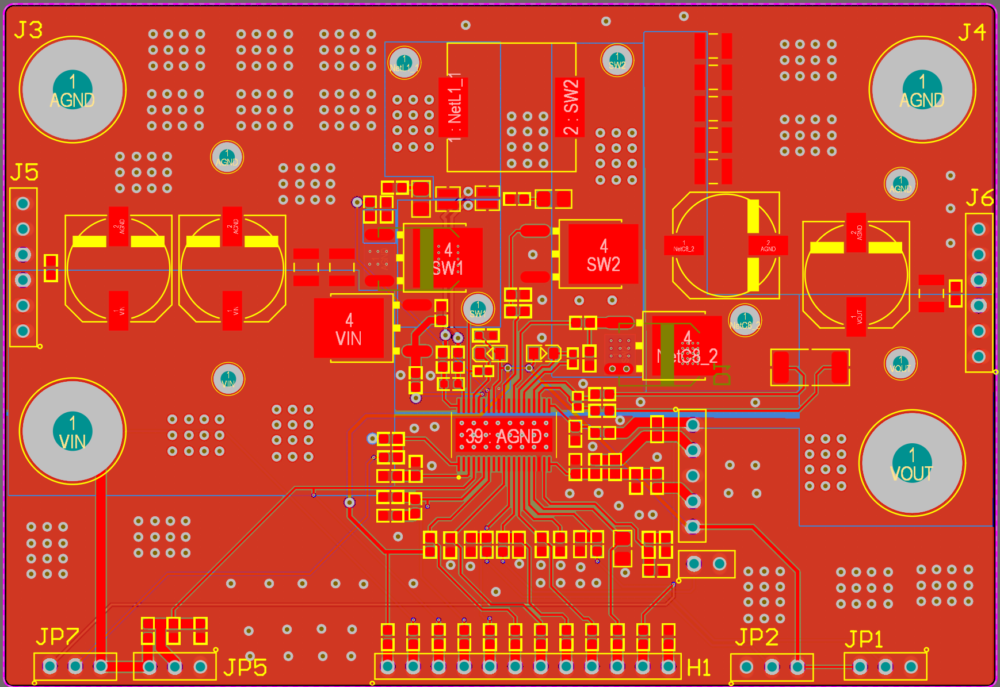
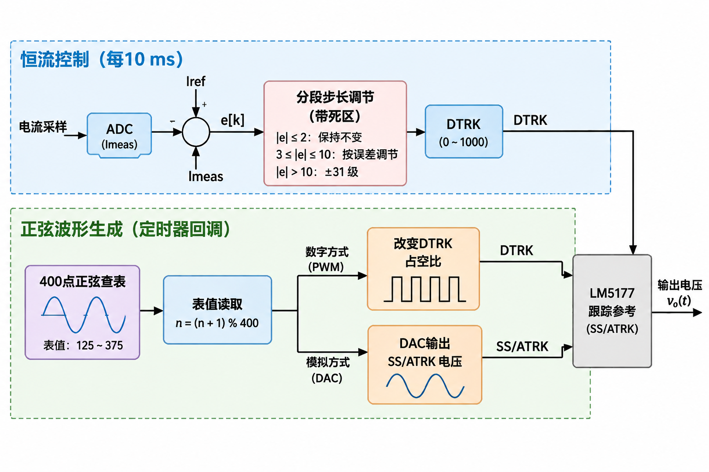
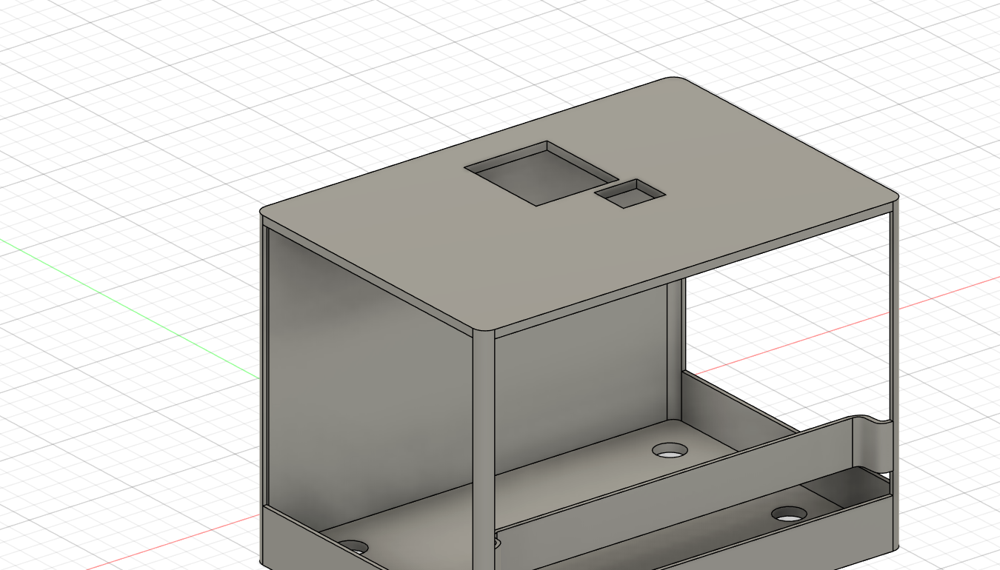

# LM5177 150 W 双向 DC-DC 电源

本项目基于 **Texas Instruments LM5177** 和 **STM32G431KBT6** 实现双向升降压电源，仓库提供 STM32 固件、Altium 原理图与 PCB、机械外壳模型以及测试数据，可用于学习、调试和二次开发。

项目主要规格为 **10-30 V 输入、0-24 V 可调输出、最大 6.25 A、最大 150 W**。

> [!NOTE]
> 150 W 工作点已可以稳定运行，对应 24 V / 6.25 A。当前仓库还未上传这部分测试数据，下方表格展示的是 16 V / 约 100 W 工作点的现有测试结果。

## 主要功能

- 四开关双向 Buck-Boost 功率级
- STM32G431KBT6 数字控制
- VIN、VOUT、IMON 和温度采样
- 限流控制、IMON 零点校准和故障锁存
- OLED 状态显示和 UART 遥测
- DTRK/PWM 与 DAC/SS-ATRK 控制路径
- 400 点正弦表和双板差分输出方案
- 可编辑 Altium、Keil、CubeMX 和 STEP 源文件

## 主要参数

| 参数 | 参数值 |
| --- | --- |
| 输入电压 | 10-30 V |
| 输出电压 | 0-24 V 可调 |
| 标称输出 | 16 V |
| 最大输出电流 | 6.25 A |
| 最大输出功率 | 150 W（24 V × 6.25 A） |
| MCU | STM32G431KBT6，LQFP32 |
| 主控制器 | TI LM5177 |

输出需要同时满足 `Vout × Iout <= 150 W` 和 `Iout <= 6.25 A`。例如，16 V / 6.25 A 对应 100 W，24 V / 6.25 A 对应 150 W。0 V 是目标调节下限，不代表已经完成 0 V 带载验证。

## 系统方案

项目由 LM5177 功率板和 STM32G431 控制部分组成：

1. LM5177、MOSFET、电感和滤波网络完成双向升降压变换。
2. STM32G431 负责采样、限流控制、参数设置、显示和遥测。
3. OLED 显示运行状态，UART 输出调试和测量数据。
4. 双板模式可通过两路输出之差生成交流分量。

图中的双板方案用于说明扩展思路，不代表已经完成 150 W 双板测试。

## 硬件

硬件工程位于 [`hardware/altium/`](hardware/altium/)，入口文件为 [`PCB_Project1.PrjPCB`](hardware/altium/PCB_Project1.PrjPCB)。目录内包含原理图、PCB、集成库和输出作业源文件。

制造前请使用 Altium Designer 编译工程，并重新运行 ERC、DRC 和输出文件检查。仓库当前不包含制造文件包。

## 固件

固件位于 [`firmware/`](firmware/)，包含 CubeMX 配置、Keil 工程、应用代码、BSP 和 STM32 HAL/CMSIS 驱动。

主要实现包括：

- 10 ms 限流控制任务
- 100 ms 显示和遥测更新
- IMON、VIN、VOUT 和温度采样
- IMON 手动/自动零点校准
- 过流与电压保护检查
- DTRK 软件等级 0-1000 映射到 TIM3 比较值 0-32
- TIM3 采用 8 MHz 时钟，DTRK PWM 配置为 250 kHz

更详细的采样与校准说明见 [`firmware/IMON_CALCULATION.md`](firmware/IMON_CALCULATION.md)。

## 测试数据

以下为 16 V / 约 100 W 工作点的测试数据，150 W 版本的数据将在整理后补充。测试环境为 25 °C、裸板自然散热，纹波测试带宽限制为 20 MHz，负载为可调电阻负载。

### 稳态测试

| 输入设定 | 输出电流设定 | 输入实测 | 输入电流 | 输出实测 | 输出电流实测 | 效率 |
| --- | --- | --- | --- | --- | --- | --- |
| 10 V | 0 A | 10.06 V | 0.102 A | 15.96 V | 0 A | - |
| 10 V | 1 A | 10.00 V | 1.740 A | 15.95 V | 1.00 A | 91.67% |
| 10 V | 3 A | 9.93 V | 5.210 A | 15.95 V | 3.05 A | 94.03% |
| 16 V | 0 A | 16.00 V | 0.164 A | 15.965 V | 0 A | - |
| 16 V | 1 A | 16.00 V | 1.201 A | 15.97 V | 1.00 A | 83.11% |
| 16 V | 3 A | 16.00 V | 3.296 A | 15.96 V | 2.98 A | 90.19% |
| 16 V | 5 A | 16.05 V | 5.400 A | 15.94 V | 4.95 A | 91.04% |
| 30 V | 0 A | 30.00 V | 0.167 A | 15.97 V | 0 A | - |
| 30 V | 1 A | 30.00 V | 0.705 A | 15.96 V | 1.00 A | 75.46% |
| 30 V | 3 A | 30.00 V | 1.776 A | 15.95 V | 3.03 A | 90.71% |
| 30 V | 6.25 A | 30.00 V | 3.770 A | 15.90 V | 6.51 A | 91.52% |

最高记录点为 15.90 V / 6.51 A，输出功率约 103.5 W。

### 电压反馈与输出纹波

| 输入 | 负载 | 输出电压 | 电压误差 | 输出纹波 |
| --- | --- | --- | --- | --- |
| 10 V | 1 A | 15.96 V | -0.25% | 122 mVpp |
| 16 V | 1 A | 15.97 V | -0.19% | 130 mVpp |
| 16 V | 5 A | - | - | 161 mVpp |
| 30 V | 1 A | 15.96 V | -0.25% | 44 mVpp |
| 30 V | 6.25 A | - | - | 48 mVpp |

### 限流误差

| 输入 | 限流设定 | 绝对误差 |
| --- | --- | --- |
| 10 V | 1 A | 0.12 A |
| 16 V | 1 A | 0.16 A |
| 30 V | 1 A | 0.09 A |

### 调整率

| 项目 | 测试条件 | 结果 |
| --- | --- | --- |
| 负载调整率 | 10 V 输入，0-3 A | 0.063% |
| 负载调整率 | 16 V 输入，0-5 A | 0.156% |
| 负载调整率 | 30 V 输入，0-6.25 A | 0.438% |
| 电压调整率 | 10/16/30 V 输入，1 A 负载 | 0.125% |
| 电压调整率 | 10/16/30 V 输入，3 A 负载 | 0.063% |

完整数据和计算公式见 [`test-data/LM5177_measurements.xlsx`](test-data/LM5177_measurements.xlsx)。

## 机械外壳

[`mechanical/`](mechanical/) 提供 STEP、OBJ、MTL 和 PNG 文件。修改外壳时建议优先使用 STEP 源模型。

## 目录结构

| 路径 | 内容 |
| --- | --- |
| [`firmware/`](firmware/) | STM32 固件、CubeMX 和 Keil 工程 |
| [`hardware/altium/`](hardware/altium/) | 原理图、PCB、库和工程文件 |
| [`mechanical/`](mechanical/) | 外壳模型与预览文件 |
| [`test-data/`](test-data/) | 测试数据文件 |
| [`docs/`](docs/) | 构建、硬件、验证和发布说明 |
| [`LICENSES/`](LICENSES/) | 完整许可证文本 |

## 快速开始

### 固件

1. 阅读 [`docs/firmware/build.md`](docs/firmware/build.md)。
2. 使用 STM32CubeMX 打开 [`firmware/LM5177MCU.ioc`](firmware/LM5177MCU.ioc)。
3. 使用 Keil MDK 打开 [`firmware/MDK-ARM/LM5177MCU.uvprojx`](firmware/MDK-ARM/LM5177MCU.uvprojx)。
4. 根据自己的硬件修改电压、电流、保护和校准参数后再编译烧录。

### PCB

1. 阅读 [`docs/hardware/altium.md`](docs/hardware/altium.md)。
2. 使用 Altium Designer 打开 [`hardware/altium/PCB_Project1.PrjPCB`](hardware/altium/PCB_Project1.PrjPCB)。
3. 检查工程设置、元件库、设计规则、ERC 和 DRC。

### 测试数据

测试数据文件位于 [`test-data/LM5177_measurements.xlsx`](test-data/LM5177_measurements.xlsx)。使用前请阅读 [`docs/verification/test-data.md`](docs/verification/test-data.md)，不要将现有数据直接作为 150 W 工作点的测试结果。

## 当前状态

- [x] 150 W、24 V / 6.25 A 工作点稳定运行
- [x] 固件、PCB 和机械外壳源文件已开源
- [x] 16 V / 约 100 W 工作点测试数据已上传
- [ ] 补充 150 W 版本测试数据、波形和温升记录

完整测试数据见 [`test-data/LM5177_measurements.xlsx`](test-data/LM5177_measurements.xlsx)。

## 安全说明

本项目涉及较高电流、储能元件和开关电源。上电前请使用限流电源、保险丝、预充和放电措施，并确认探头、负载、散热和接地方式正确。不要在无人值守或缺少防护的情况下测试。

## 许可证

仓库使用混合许可证：固件采用 GPL-3.0-or-later，硬件和机械文件采用 CERN-OHL-S-2.0，文档和测试数据采用 CC-BY-SA-4.0。详情见 [`LICENSE`](LICENSE) 和 [`THIRD_PARTY_NOTICES.md`](THIRD_PARTY_NOTICES.md)。

贡献代码前请阅读 [`CONTRIBUTING.md`](CONTRIBUTING.md)；安全问题请参阅 [`SECURITY.md`](SECURITY.md)。

SPDX-License-Identifier: CC-BY-SA-4.0
SPDX-FileCopyrightText: 2026 LM5177 Power Converter Project Contributors
